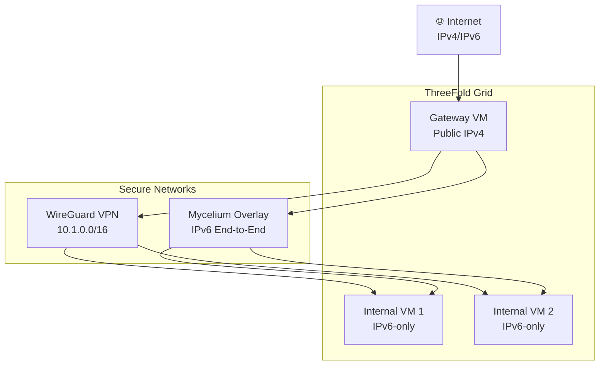
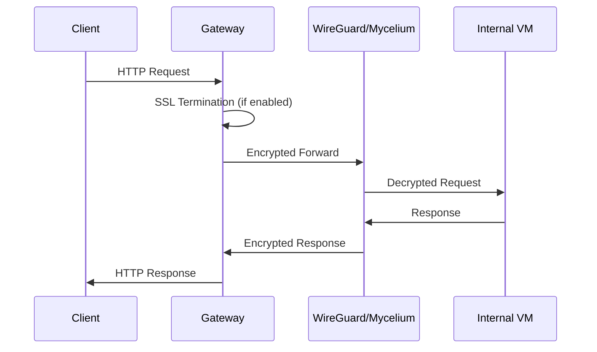
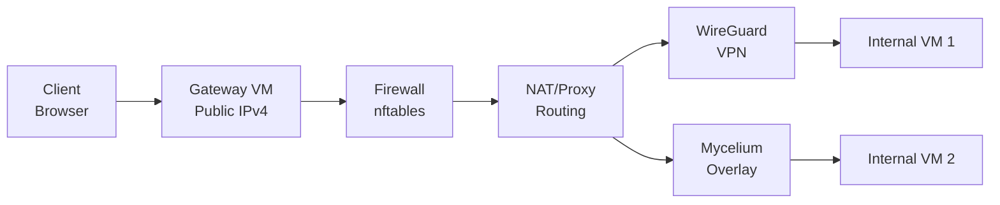

# ThreeFold Grid IPv4 Gateway

# The Challenge

## IPv4 Exhaustion & the IPv6 Transition

**The Global IPv4 Crisis:**
- IPv4 address space exhausted since 2011
- Only ~4.3 billion possible IPv4 addresses
- NAT and CGNAT workarounds create complexity
- Legacy systems remain IPv4-dependent

**IPv6 as the Solution:**
- 340 undecillion (2^128) possible addresses
- Native end-to-end connectivity
- Eliminates need for NAT complexity
- Future-proof networking architecture

**The Adoption Gap:**
- IPv6 deployment lags behind (still <50% global adoption)
- Legacy IPv4-only clients and services persist
- Enterprise networks often IPv4-centric
- IoT devices and embedded systems remain IPv4

**ThreeFold Grid's IPv6-First Approach:**
- All VMs are IPv6-native by design
- Mycelium provides end-to-end encrypted IPv6 overlay
- WireGuard enables secure IPv6 connectivity
- Modern networking for the decentralized cloud

**The Connectivity Challenge:**
- How to bridge IPv6-only infrastructure with IPv4-dominated internet?
- How to provide seamless access for legacy IPv4 clients?
- How to maintain security while enabling interoperability?

**Industry Context:**
- Enterprises in transition phase (dual-stack networks)
- Cloud providers offering IPv6 but maintaining IPv4 compatibility
- Regulatory requirements for IPv6 support emerging
- Security implications of IPv4/IPv6 coexistence

---

# Solution: tfgrid-gateway

## The Smart Bridge Between IPv6 & IPv4 Worlds

**What tfgrid-gateway Does:**
- **IPv4 Gateway Creation**: Deploys VMs with public IPv4 addresses on ThreeFold Grid
- **Traffic Routing**: Directs internet traffic to your IPv6-only applications
- **Dual Network Support**: Uses both WireGuard VPN and Mycelium overlay networks
- **Simple Deployment**: One command sets up everything automatically

**How It Solves the Problem:**
- **Legacy Compatibility**: IPv4-only devices can access your IPv6 services
- **Future-Proof**: Supports IPv6 adoption while maintaining IPv4 access
- **Secure Connectivity**: Encrypted tunnels protect all communications
- **High Availability**: Redundant networks ensure continuous operation

**Two Gateway Options:**

**NAT Gateway (Simple & Fast):**
- Like a network address translator - forwards traffic directly by port
- Best for: Development, testing, simple applications
- Example: Your website at gateway-ip:8080 reaches VM1

**Proxy Gateway (Advanced & Secure):**
- Like a smart traffic director - handles SSL, load balancing, routing
- Best for: Production, customer-facing applications
- Example: Your website at gateway-domain.com reaches VM1

**Why This Matters:**
- **Enables IPv6 Adoption**: Use modern networking without breaking legacy systems
- **Reduces Complexity**: No need to manage IPv4 address allocation
- **Cost Effective**: Leverages ThreeFold Grid's decentralized infrastructure
- **Enterprise Ready**: Production features with automated SSL and monitoring

---

# Core Features

- ✅ **Public IPv4 Gateway**: VMs with dedicated public IPv4 addresses
- ✅ **Multiple Gateway Types**: NAT or reverse proxy implementations
- ✅ **Network Redundancy**: WireGuard, Mycelium, or both
- ✅ **SSL/TLS Support**: Free Let's Encrypt certificates
- ✅ **Automated Deployment**: Single command setup
- ✅ **Live Demo System**: Multi-VM demonstration environment

---

# Architecture Overview

Here's how tfgrid-gateway connects your appcations to the internet: public IPv4 gateway routes traffic through secure networks to internal IPv6 VMs.



---

# Gateway VM Configuration

## Public IPv4 with Secure Routing

- **Public IPv4 Address**: Direct internet connectivity
- **Firewall Rules**: nftables-based security
- **Traffic Routing**: NAT or reverse proxy
- **SSL Termination**: Optional HTTPS support
- **Load Balancing**: For multi-VM deployments

---

# Internal VMs

## IPv6-Only Application Hosts

- **No Public IP**: Enhanced security
- **Secure Access**: Via WireGuard or Mycelium
- **Application Hosting**: Web services, APIs, databases
- **Network Isolation**: Protected from direct internet exposure

---

# Gateway Types: NAT vs Proxy

## Choose Your Implementation

**You can select the gateway type that best fits your requirements:**

- Choose **NAT** for simple, resource-efficient deployments
- Choose **Proxy** for production environments needing SSL, load balancing, and advanced routing
- Configure via the `GATEWAY_TYPE` environment variable in your `.env` file

---

# NAT Gateway (Default)

## Traditional Network Address Translation

**Technology:** Linux nftables NAT (Layer 3/4)

**How it Works:**
- Network Address Translation at the gateway level
- Direct port forwarding to internal VMs
- Gateway:8081 → VM1:8081, Gateway:8082 → VM2:8082

**Industry Use Cases:**
- **Development/Testing**: Quick deployment for internal teams
- **Simple Web Services**: Basic HTTP/HTTPS applications
- **Legacy Applications**: Systems requiring direct port access
- **Resource-Constrained Environments**: Minimal overhead deployments

**Pros:**
- ✅ Simple configuration and troubleshooting
- ✅ Low resource consumption
- ✅ Direct VM access and control
- ✅ Fast deployment for development

**Cons:**
- ❌ No built-in SSL/TLS termination
- ❌ Limited to port-based routing
- ❌ No advanced load balancing features

---

# Proxy Gateway

## Enterprise Reverse Proxy Solution

**Technology:** HAProxy (Layer 4/7) + Nginx (Layer 7)

**How it Works:**
- Application-layer reverse proxy with intelligent routing
- Content-based load balancing and SSL termination
- Gateway/web1 → VM1, Gateway/web2 → VM2

**Industry Use Cases:**
- **Production Web Applications**: Customer-facing services requiring high availability
- **API Gateways**: Microservices with advanced routing needs
- **E-commerce Platforms**: Secure transaction processing
- **Enterprise Applications**: Multi-tenant SaaS platforms
- **Content Delivery**: CDN-like functionality with caching

**Pros:**
- ✅ Full SSL/TLS termination and management
- ✅ Advanced load balancing algorithms (round-robin, least connections, etc.)
- ✅ Health monitoring and automatic failover
- ✅ Content-based routing and URL rewriting
- ✅ Enterprise security features (WAF, rate limiting)

**Cons:**
- ❌ Higher resource requirements
- ❌ More complex configuration
- ❌ Additional latency from proxy processing

---

# Networking Options

## Flexible Connectivity

### WireGuard VPN
- **Encrypted tunnels** between VMs
- **Reliable** for complex setups
- **Better performance** for large deployments

### Mycelium Overlay
- **End-to-end encrypted** IPv6 overlay
- **Useful** when WireGuard has issues
- **Native IPv6 connectivity**

### Dual Network Mode
- **Complete redundancy**: Both WireGuard and Mycelium active simultaneously
- **Automatic failover**: If one network fails, traffic automatically routes through the other
- **Continuous availability**: Internal VM websites remain accessible even if one network goes down
- **Load balancing**: Traffic distributed across both networks for optimal performance

## Network Flow

Here's how a typical request flows through tfgrid-gateway: client sends HTTP request, gateway handles SSL if enabled, encrypts and forwards through secure networks to internal VMs.


---

# Security Architecture

## Multi-Layer Protection

Here's how client requests flow through tfgrid-gateway's security layers: a client browser connects to the IPv4 gateway, passes through the firewall and routing layers, then flows through encrypted networks to reach the internal VMs.



**Security Features:**
- 🔒 Encrypted overlay networks
- 🛡️ nftables firewall rules
- 🔑 SSH key-based access
- 📋 Optional SSL/TLS termination

---

# Live Demo System

## Multi-VM Demonstration

**Features:**
- Multiple internal VMs with status pages
- Network mode demonstrations
- Load balancing showcase
- SSL certificate examples

---

# Deployment Process

## One-Command Setup

```bash
# 1. Clone and configure
git clone https://github.com/mik-tf/tfgrid-gateway
cd tfgrid-gateway
cp infrastructure/credentials.auto.tfvars.example infrastructure/credentials.auto.tfvars
cp .env.example .env
nano infrastructure/credentials.auto.tfvars  # Configure node IDs
nano .env  # Configure deployment settings

# 2. Set mnemonic
export TF_VAR_mnemonic="your_mnemonic"

# 3. Deploy everything
make
```

**What happens:**
1. Terraform provisions infrastructure
2. Ansible generates inventory
3. WireGuard/Mycelium networks setup
4. Gateway and VMs configured
5. Demo system deployed

---

# Configuration Options

## Two Configuration Files Required

**1. Infrastructure Configuration (`infrastructure/credentials.auto.tfvars`):**
```bash
# ThreeFold Grid node IDs for your VMs
gateway_node = 1234    # Node ID for gateway VM
internal_nodes = [5678, 9012]  # Node IDs for internal VMs
```

**2. Deployment Configuration (`.env`):**
```bash
GATEWAY_TYPE=gateway_proxy    # or gateway_nat
NETWORK_MODE=both            # wireguard-only, mycelium-only, both
ENABLE_SSL=true              # for HTTPS
DOMAIN_NAME=mygateway.com    # for SSL
```

**Network Configuration Options:**
- `MAIN_NETWORK`: Controls how Ansible connects to VMs (public/wireguard/mycelium)
- `INTER_NODE_NETWORK`: VM-to-VM communication (wireguard/mycelium)

---

# Benefits

## Why tfgrid-gateway?

- 🚀 **Easy Deployment**: Single command setup
- 🔒 **Secure by Design**: Encrypted networks, firewall protection
- 🌐 **Internet Connectivity**: IPv4 access for IPv6 workloads
- ⚡ **High Performance**: Optimized routing and load balancing
- 💰 **Cost Effective**: ThreeFold Grid's competitive pricing
- 🔧 **Flexible Configuration**: Multiple gateway and network options

---

# Getting Started

## Quick Start Guide

1. **Prerequisites:**
   - Linux/macOS system
   - OpenTofu/Terraform
   - Ansible, WireGuard
   - ThreeFold account

2. **Deploy:**
   ```bash
   # Option 1: One-command deployment (recommended)
   make  # Runs infrastructure + ansible + demo

   # Option 2: Step-by-step
   make infrastructure  # Provision VMs
   make ansible        # Configure gateway
   make demo          # Deploy demo
   ```

3. **Access your gateway:**

- **IPv4 Address**: `http://YOUR_GATEWAY_IP`
- **Domain Name**: `https://yourdomain.com` (with SSL)

---

# Advanced Features

## Production-Ready Capabilities

- **SSL/TLS**: Automatic Let's Encrypt certificates
- **Monitoring**: Built-in health checks and logging
- **Scaling**: Support for multiple internal VMs
- **Backup**: Configuration and certificate management
- **Updates**: Rolling updates and maintenance

---

# Appendix

## Technical Details

### Infrastructure Components
- Terraform modules for VM provisioning
- Ansible roles for configuration management
- Makefile for orchestration

### Network Architecture
- WireGuard: Layer 3 VPN
- Mycelium: End-to-end encrypted overlay
- nftables: Modern firewall framework

### Security Measures
- SSH key authentication
- Network segmentation
- Encrypted communication channels

---

# Appendix: Code Examples

## Basic Deployment

```bash
# Environment setup
export TF_VAR_mnemonic="$(cat ~/.config/threefold/mnemonic)"
export GATEWAY_TYPE=gateway_proxy
export NETWORK_MODE=both

# Deploy
make
```

## SSL Configuration

```bash
export DOMAIN_NAME=mygateway.example.com
export ENABLE_SSL=true
make ssl-demo
```
